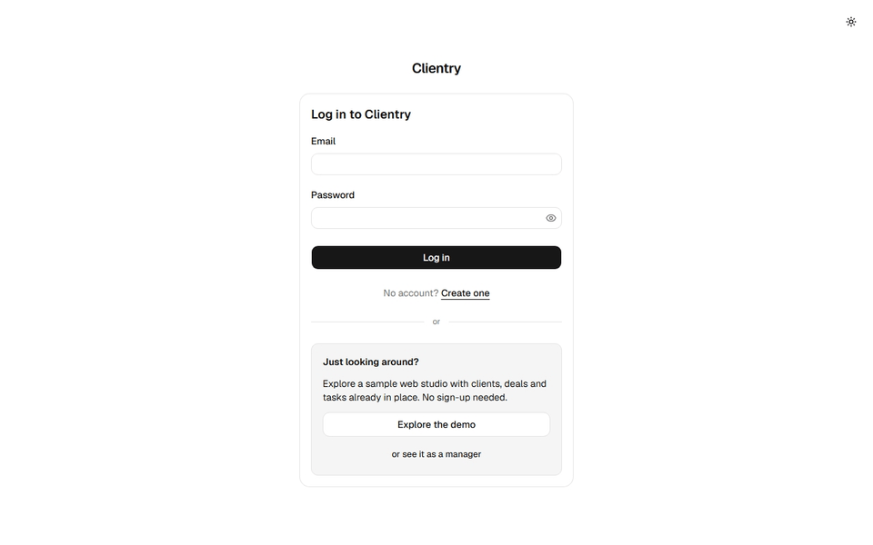
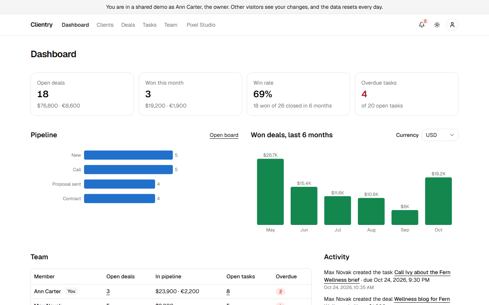
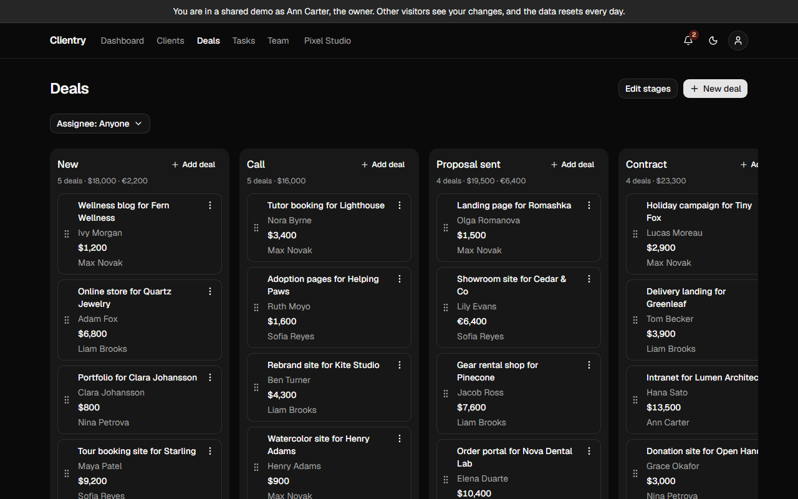
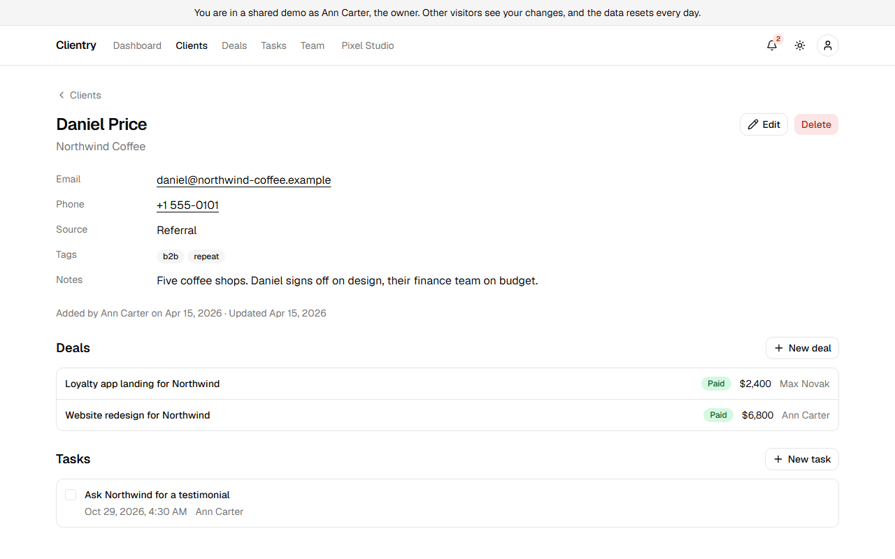
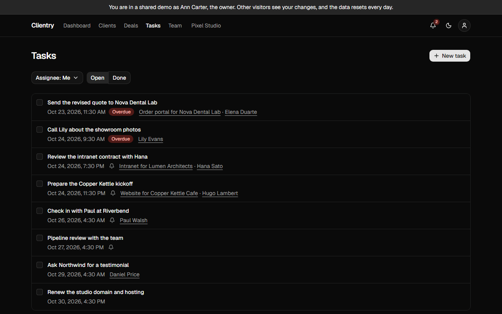
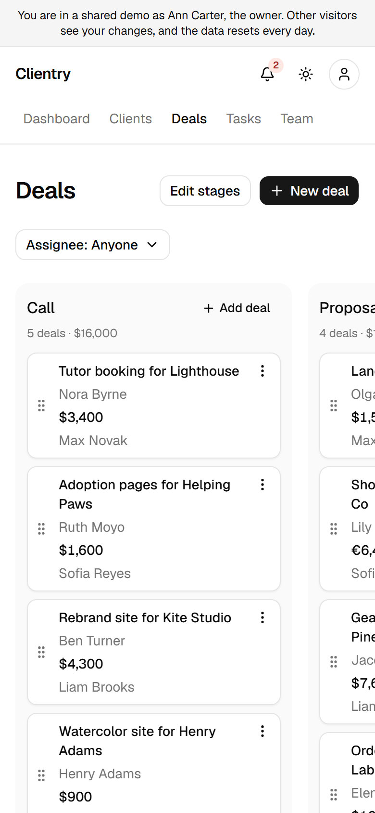
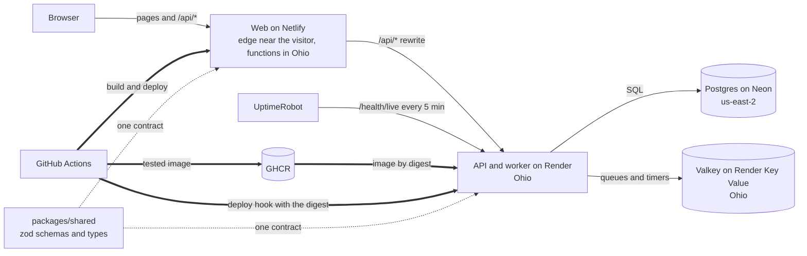

# Clientry

A lightweight CRM for small teams: clients, a deal pipeline, tasks with reminders and a team with
roles.

[](https://github.com/Vladimir0087/clientry/actions/workflows/ci.yml?query=branch%3Amain+event%3Apush)
[](LICENSE)
[](https://clientry.netlify.app)

## Live demo

**[clientry.netlify.app](https://clientry.netlify.app)**: press **Explore the demo** to sign in
without signing up, as the owner of a small web studio; the button under it, **or see it as a
manager**, shows what the other role may do. The demo is shared with other visitors and rebuilt
every day, so any change you make lasts a day at most.

The API reference is at [/api/docs](https://clientry.netlify.app/api/docs) (Swagger UI).



## What it does

- **Clients**: contacts with notes, tags and a source; search and filters that live in the URL.
- **Deals**: a board with the team's stages; drag a deal, or move it from the keyboard, and its
  history records who moved it and when.
- **Tasks and reminders**: follow-ups for a client or a deal with a due time and an assignee, who
  gets an in-app reminder at the chosen time.
- **Team and roles**: the owner invites managers with one-time links, changes roles and shapes the
  pipeline; a manager may delete only their own clients and deals.
- **Dashboard**: open deals by stage, money in the pipeline, deals won and the win rate over six
  months, who works on what, and a feed of what the team did.
- **Demo**: one click into a filled workspace, as the owner or as a manager.

It works on a phone, in a light and a dark theme.

## Screenshots

<table>
  <tr>
    <td></td>
    <td></td>
  </tr>
  <tr>
    <td>The owner's dashboard</td>
    <td>The deal board, dark theme</td>
  </tr>
  <tr>
    <td></td>
    <td></td>
  </tr>
  <tr>
    <td>A client with their deals and tasks</td>
    <td>Open tasks, overdue and due today, dark theme</td>
  </tr>
  <tr>
    <td colspan="2" align="center"><br>The board on a phone scrolls sideways, a column at a time</td>
  </tr>
</table>

## Architecture



Thin arrows are requests at runtime, thick ones are deploys from CI, dotted ones are code that both
apps build from.

- **The API is a modular monolith**: a NestJS module per domain, each layered controller → service
  → repository, with Prisma reachable only from repositories.
- **The web follows a light Feature-Sliced Design**: app, features, entities and shared, with the
  slice boundaries checked by lint; Next.js renders the shells and prefetches, the rest is a
  client-side app on TanStack Query.
- **One zod contract for both sides**: the schemas in `packages/shared` validate the web's forms,
  the API's requests and responses, and generate the Swagger document.
- **The worker runs in the API's process**: BullMQ delivers reminders, purges old sessions and
  rebuilds the demo without a second service.

## Engineering highlights

- **Tenant isolation by construction**: every repository method takes the workspace id of the
  session first, never one from the request, and another workspace's record answers 404
  ([ADR 0002](docs/adr/0002-backend-architecture.md), [spec 06](docs/specs/06-clients.md)).
- **Sessions**: refresh tokens rotate on every use and a reused one revokes the session; ES256
  access tokens sit in httpOnly cookies; the browser talks to one origin through the web's rewrite
  ([ADR 0005](docs/adr/0005-authentication.md), [ADR 0007](docs/adr/0007-web-session.md)).
- **A consistent board**: a deal's move and its history entry commit in one transaction, guarded by
  a record version; the board moves the card at once and puts it back when the server refuses
  ([ADR 0010](docs/adr/0010-deal-board.md), [spec 07](docs/specs/07-deals.md)).
- **Reminders exactly once**: Postgres is the source of truth and Valkey holds only near timers; the
  worker marks a reminder sent and writes its notification in one transaction
  ([ADR 0012](docs/adr/0012-reminders.md)).
- **Lists that scale**: cursor pagination and trigram-indexed search
  ([ADR 0009](docs/adr/0009-client-search-and-pagination.md)).
- **One error format**: problem details (RFC 9457, the successor of RFC 7807), with validation
  errors per field that the forms show next to their inputs
  ([ADR 0004](docs/adr/0004-request-validation.md)).
- **Operable**: request ids in structured pino logs; liveness apart from readiness, so the host's
  health check never wakes the database; a graceful shutdown
  ([spec 02](docs/specs/02-api-foundation.md)).
- **A demo that holds**: team actions are locked in the shared demo, so nobody takes it over, and
  it is rebuilt every day ([ADR 0016](docs/adr/0016-demo-workspace.md)).

## Tech stack

| Layer         | Tools                                                                                 |
| ------------- | ------------------------------------------------------------------------------------- |
| API           | NestJS 12, TypeScript, Prisma 7 with the pg driver adapter, PostgreSQL 18             |
| Jobs          | BullMQ on Valkey 8.1                                                                  |
| Auth          | jose (ES256 JWT), argon2, @nestjs/throttler                                           |
| Validation    | zod 4 in `packages/shared`, Nest 12's native Standard Schema support, @nestjs/swagger |
| Logs          | pino through nestjs-pino                                                              |
| Web           | Next.js 16 (App Router), React 19, Tailwind CSS 4, shadcn/ui on Radix                 |
| Web state     | TanStack Query, react-hook-form, nuqs, next-themes, sonner                            |
| Board, charts | dnd-kit, recharts                                                                     |
| Tests         | Vitest, Testing Library, MSW, testcontainers, Playwright, axe-core                    |
| Tooling       | pnpm workspaces, Turborepo, ESLint, Prettier, husky, commitlint                       |
| Delivery      | GitHub Actions, GHCR, Netlify, Render, Neon, UptimeRobot                              |

## Run it locally

Requirements: Node 24 or newer, pnpm 12, Docker.

```sh
pnpm install
pnpm dev:setup   # .env with a fresh key pair, Postgres and Valkey in Docker, migrations
pnpm dev         # the API and the web, with hot reload
```

Open http://localhost:3000 and press **Explore the demo**: the API builds the demo workspace when
it first starts. `pnpm dev:setup` never changes an existing `.env` and is safe to run again.

| Port | What                               | When it is taken                                                                                    |
| ---- | ---------------------------------- | --------------------------------------------------------------------------------------------------- |
| 3000 | the web                            | fixed in the web's scripts: stop the other process                                                  |
| 4000 | the API, Swagger UI at `/api/docs` | in `.env`: `PORT`, the port in `API_URL` and the `http://localhost:4000` entry of `TRUSTED_ORIGINS` |
| 5432 | Postgres in Docker                 | in `.env`: `POSTGRES_PORT` and the port in `DATABASE_URL`                                           |
| 6379 | Valkey in Docker                   | in `.env`: `VALKEY_PORT` and the port in `REDIS_URL`                                                |

After a port change, run `pnpm dev:setup` again. `pnpm e2e` and `pnpm media` always run on 3000
and 4000 and build the web with `API_URL=http://127.0.0.1:4000` from `.env`
([docs/testing.md](docs/testing.md)).

## Tests

- **Unit and component**: services with doubled repositories, guards and schemas; the web's
  screens in jsdom with Testing Library and the API faked by MSW.
- **Integration**: each API module over HTTP against real Postgres and Valkey in testcontainers,
  with two workspaces to prove isolation.
- **End-to-end**: the product scenarios, the demo, the phone layout and axe checks in Playwright
  against production builds of the API and the web.

`pnpm test` runs the first two and needs Docker; `pnpm e2e` builds both apps and runs the third.
Details, including the one-time browser install, are in [docs/testing.md](docs/testing.md).

## Deployment

Everything runs on free tiers in one region, Ohio: the web on Netlify, the API on Render, Postgres
on Neon and Valkey on Render Key Value. Every push to `main` runs CI; when lint, types, tests,
the image and the end-to-end suite pass, CI deploys the very image digest it tested, then the web,
and walks through the live demo. Setup, operations and limits are in
[docs/deployment.md](docs/deployment.md).

## Decisions

Each lasting decision has an architecture decision record in [docs/adr](docs/adr): the context, the
choice, the alternatives and their costs.

<details>
<summary>The decision records</summary>

| ADR                                                   | Decision                                                                                        |
| ----------------------------------------------------- | ----------------------------------------------------------------------------------------------- |
| [0001](docs/adr/0001-monorepo-tooling.md)             | pnpm workspaces and Turborepo; `packages/shared` compiled, with an entry point per domain       |
| [0002](docs/adr/0002-backend-architecture.md)         | a separate NestJS API as a modular monolith; Prisma only in repositories; the workspace first   |
| [0003](docs/adr/0003-database-access.md)              | PostgreSQL with Prisma 7 and the pg driver adapter; SQL migrations deployed before start        |
| [0004](docs/adr/0004-request-validation.md)           | zod schemas in `packages/shared` through Nest 12's Standard Schema support; no DTO classes      |
| [0005](docs/adr/0005-authentication.md)               | ES256 access tokens and rotating refresh tokens in httpOnly cookies, with reuse detection       |
| [0006](docs/adr/0006-frontend-architecture.md)        | Next.js as an SPA with server-rendered shells; light Feature-Sliced Design; no global store     |
| [0007](docs/adr/0007-web-session.md)                  | the web's proxy verifies the token with the public key; refresh only in the browser             |
| [0008](docs/adr/0008-deployment.md)                   | the API image built once in CI and deployed by digest; the API before the web                   |
| [0009](docs/adr/0009-client-search-and-pagination.md) | keyset pagination with opaque cursors; search backed by trigram indexes                         |
| [0010](docs/adr/0010-deal-board.md)                   | fractional positions, a record version, minor units with a currency per deal, history snapshots |
| [0011](docs/adr/0011-web-on-netlify.md)               | the web on Netlify, built and deployed by its CLI in CI                                         |
| [0012](docs/adr/0012-reminders.md)                    | Postgres as the source of truth for reminders, Valkey for near timers, delivery exactly once    |
| [0013](docs/adr/0013-team-access.md)                  | one-time hashed invite links and one permission matrix for the API and the web                  |
| [0014](docs/adr/0014-dashboard.md)                    | dashboard aggregates computed in SQL in one snapshot; month bounds from the browser             |
| [0015](docs/adr/0015-backend-in-ohio.md)              | the API and its data next to the web's server function, in Ohio                                 |
| [0016](docs/adr/0016-demo-workspace.md)               | one shared demo, rebuilt daily, with owner and manager entries and team actions locked          |
| [0017](docs/adr/0017-e2e-tests.md)                    | Playwright against production builds and testcontainers; a read-only tour of the live demo      |
| [0018](docs/adr/0018-public-repository.md)            | a ruleset on `main` without bypass, deploy secrets for `main` only, scripted README media       |

</details>

The project is built one spec at a time: each is written and approved before any code and ships as
one pull request with the spec inside. The specs and their index are in [docs/specs](docs/specs).

## Roadmap

What each release brought is in the [changelog](CHANGELOG.md). Next:

- A realtime board and notification bell over WebSocket.
- Custom fields on clients and deals.
- Email notifications.
- Several workspaces per user, and deleting a workspace.
- Client import from CSV.
- A Telegram bot for leads and reminders.
- Workspace subscriptions in a payment provider's test mode.

## License

[MIT](LICENSE)
