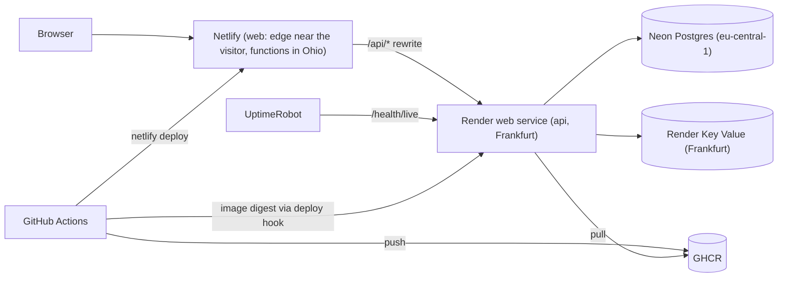

# Deployment

How Clientry runs on free hosting (stage 1) and how to set it up, deploy, roll back and rotate
secrets. Decisions and their reasons are in [ADR 0008](adr/0008-deployment.md) and, for the web
on Netlify, [ADR 0011](adr/0011-web-on-netlify.md).

## Topology



- The browser talks to the Netlify origin only; Next rewrites `/api/*` to the API.
- Every push to `main` runs CI; after `lint`, `typecheck`, `test` and `image` pass, `deploy-api`
  deploys the tested image digest to Render, then `deploy-web` builds the web and deploys it to
  Netlify. Neither host is connected to the repository.

## Live

Filled in at setup. Names may carry a suffix where the plain one is taken.

| What                 | Value                                                                                                |
| -------------------- | ---------------------------------------------------------------------------------------------------- |
| Web                  | `https://<site>.netlify.app`                                                                         |
| Swagger UI           | `https://<site>.netlify.app/api/docs`                                                                |
| API probes           | `https://clientry-api.onrender.com/health/live`                                                      |
| Render web service   | `clientry-api`                                                                                       |
| Render Key Value     | `clientry-valkey`                                                                                    |
| Neon project         | `clientry` (`little-math-93508455`), branch `production`, database `clientry`, role `clientry_owner` |
| Netlify site         | `<site>` (`<site id>`), team on the legacy Free plan                                                 |
| Image                | `ghcr.io/vladimir0087/clientry-api` (private)                                                        |
| UptimeRobot monitors | API liveness, web login                                                                              |
| `TRUST_PROXY_HOPS`   | `<measured value>`, measured on `<date>`                                                             |

## Consoles

All accounts are the owner's personal ones (personal email, not a work address).

| Service                      | Console                                                                       |
| ---------------------------- | ----------------------------------------------------------------------------- |
| Neon                         | https://console.neon.tech/app/projects/little-math-93508455                   |
| Render                       | https://dashboard.render.com                                                  |
| Netlify                      | https://app.netlify.com                                                       |
| Netlify tokens               | https://app.netlify.com/user/applications#personal-access-tokens              |
| GHCR package                 | https://github.com/users/Vladimir0087/packages/container/package/clientry-api |
| GitHub Actions               | https://github.com/Vladimir0087/clientry/actions                              |
| GitHub secrets               | https://github.com/Vladimir0087/clientry/settings/secrets/actions             |
| GitHub tokens (classic)      | https://github.com/settings/tokens                                            |
| GitHub tokens (fine-grained) | https://github.com/settings/personal-access-tokens                            |
| GitHub installed apps        | https://github.com/settings/installations                                     |
| UptimeRobot                  | https://dashboard.uptimerobot.com                                             |

## First-time setup

In this order: each step needs a value from the one before.

### 1. Production key pair

On the owner's machine, once:

```sh
pnpm --silent --filter @clientry/api jwt:keygen
```

The private line goes only to Render, the public line only to Netlify. Neither is stored anywhere
else, the repository included.

### 2. Neon

1. Create project `clientry`: Postgres 18, region AWS `eu-central-1` (Frankfurt), Free plan,
   service Postgres database only. Name the database `clientry` in the same form; Neon creates
   the role `clientry_owner`, one role for migrations and the app. The default branch is
   `production`.
2. Connect → branch `production`, database `clientry`, role `clientry_owner`, connection pooling
   off. Copy the **direct** connection string (without `-pooler` in the host).
3. Replace its whole query string, `channel_binding` included, with
   `?sslmode=verify-full&sslaccept=strict`:
   - pg in the API reads `sslmode`: `verify-full` checks the certificate and the host name.
     Neon's `sslmode=require` means the same to pg today but prints a deprecation warning on
     every start;
   - Prisma's schema engine (`migrate deploy`) knows only `prefer`, `disable` and `require`,
     treats other values as `prefer`, and verifies the certificate only with `sslaccept=strict`.
     Neon refuses plain-text connections, so migrations never run without TLS.

   This is `DATABASE_URL` for Render.

### 3. Render Key Value

Free plan, region Frankfurt, `maxmemory-policy` `noeviction` (BullMQ requires it: eviction would
drop queued jobs silently), no entries in the IP allow list, so only services in the same region
reach it. Its **internal** URL is `REDIS_URL` for Render.

### 4. First image

GitHub → Actions → CI → Run workflow, on the branch being set up, with **deploy unchecked**. The
`image` job publishes `ghcr.io/vladimir0087/clientry-api:latest` and `:sha-<commit>`. The
package is linked to the repository by the image's source label and stays private.

GitHub shows the Run workflow button only once `main` has a workflow with `workflow_dispatch`.
Before the first merge, dispatch through the REST API with a fine-grained token limited to this
repository with **Actions: read and write**:

```powershell
$env:GH_TOKEN = Read-Host 'GitHub token'
$headers = @{ Authorization = "Bearer $env:GH_TOKEN"; Accept = 'application/vnd.github+json' }
$body = '{"ref":"<branch>","inputs":{"deploy":"false"}}'
Invoke-RestMethod -Method Post -Headers $headers -Body $body `
  -Uri 'https://api.github.com/repos/Vladimir0087/clientry/actions/workflows/ci.yml/dispatches'
```

No output means GitHub accepted it; the run appears under Actions. `"deploy":"true"` deploys.

### 5. Registry credential for Render

GitHub → Settings → Developer settings → Personal access tokens → **Tokens (classic)**, scope
`read:packages` only, expiring in one year (fine-grained tokens cannot read packages). In Render →
Workspace settings → Registry credentials, add it for `ghcr.io` with username `Vladimir0087`.
Write the expiry date into [Expiry and rotation](#expiry-and-rotation).

### 6. Netlify site

The owner's existing Netlify account, signed in with GitHub. Its team is on the legacy Free plan:
Usage & billing → Plan details shows "Free plan" with build minutes and bandwidth, no credits.
**Never change the plan.** A move to credit-based pricing cannot be undone, and its free tier
pauses every site when the month's credits run out.

1. User settings → Applications → Personal access tokens → New access token, named `clientry-ci`,
   with the longest expiry offered. It becomes `NETLIFY_AUTH_TOKEN`; write its expiry into
   [Expiry and rotation](#expiry-and-rotation).
2. Create the site through the REST API, so Netlify never gets access to the repository
   (importing the repository in the panel would connect it):

   ```powershell
   $env:NETLIFY_AUTH_TOKEN = Read-Host 'Netlify token'
   $headers = @{ Authorization = "Bearer $env:NETLIFY_AUTH_TOKEN" }
   Invoke-RestMethod -Method Post -Headers $headers -ContentType 'application/json' `
     -Body '{"name":"clientry"}' -Uri 'https://api.netlify.com/api/v1/sites' |
     Select-Object id, name, ssl_url
   Remove-Item Env:NETLIFY_AUTH_TOKEN
   ```

   A taken name is refused; pick another. `id` is `NETLIFY_SITE_ID`, `ssl_url` the web origin.

3. Project configuration → Build & deploy → Continuous deployment → Build settings: builds
   **stopped**. Netlify then never builds by itself; CLI deploys still work.
4. Project configuration → Environment variables, both **plain** (not "Contains secret values"),
   the same value in every deploy context, every scope. Neither is a secret, and `API_URL` is
   baked into the build output, which Netlify's secret scanning rejects for a secret variable.
   - `API_URL`: the Render origin, `https://clientry-api.onrender.com`, no trailing slash. Filled in
     after step 7, then redeployed.
   - `JWT_PUBLIC_KEY`: the public line from step 1, everything after `JWT_PUBLIC_KEY=`.
5. Analytics, forms and snippet injection stay off: they would need CSP changes.
6. GitHub → Settings → Applications → Installed GitHub Apps: a Netlify app from earlier projects
   keeps access to "Only select repositories", never this one.

The site's origin `https://<site>.netlify.app` is the web origin from now on.

### 7. Render web service

New → Web Service → Existing image:

- image `ghcr.io/vladimir0087/clientry-api:latest` with the credential from step 5;
- region Frankfurt, instance type Free, no disk;
- health check path `/health/live`, **not** `/health/ready`: Render probes it continuously, and a
  probe that queries Postgres would keep Neon awake and spend its compute budget in under three
  weeks;
- auto-deploy off. The shutdown delay stays at Render's default 30 s, above the API's 10 s
  deadline.

Environment:

| Variable           | Value                                             |
| ------------------ | ------------------------------------------------- |
| `NODE_ENV`         | `production`                                      |
| `LOG_LEVEL`        | `info`                                            |
| `DATABASE_URL`     | from step 2 (secret)                              |
| `REDIS_URL`        | from step 3                                       |
| `JWT_PRIVATE_KEY`  | the private line from step 1 (secret)             |
| `TRUSTED_ORIGINS`  | `https://<site>.netlify.app`, the web origin only |
| `TRUST_PROXY_HOPS` | `0` until [measured](#measure-trust_proxy_hops)   |

`PORT` is Render's own and `APP_VERSION` is baked into the image; neither is set here.

Then Settings → Deploy hook: copy the URL. It is `RENDER_DEPLOY_HOOK_URL`, and anyone holding it
can deploy, so it lives only in GitHub secrets.

Set `API_URL` on Netlify (step 6) to this service's origin.

### 8. GitHub secrets and variables

Repository → Settings → Secrets and variables → Actions, at repository level (a private repository
on the free plan has no environments; they move to a `production` environment once the repository
is public).

| Name                     | Kind     | Value                               |
| ------------------------ | -------- | ----------------------------------- |
| `RENDER_DEPLOY_HOOK_URL` | secret   | step 7                              |
| `NETLIFY_AUTH_TOKEN`     | secret   | step 6                              |
| `NETLIFY_SITE_ID`        | variable | step 6                              |
| `API_PUBLIC_URL`         | variable | `https://clientry-api.onrender.com` |
| `WEB_PUBLIC_URL`         | variable | `https://<site>.netlify.app`        |

### 9. First deploy

Actions → CI → Run workflow on the branch, deploy checked. `deploy-api` deploys the digest and
waits for `/health/live` to report the commit; `deploy-web` builds the web with Netlify's CLI,
publishes it and runs `smoke-live.sh`. The site's Deploys list shows the commit as each deploy's
message.

### 10. UptimeRobot

Two HTTP(S) monitors, 5-minute interval, no notifications (the email alert contact is unchecked
on both); their status is visible in the dashboard:

- `GET https://clientry-api.onrender.com/health/live`: keeps the API awake without touching the
  database. 31 days × 24 h = 744 h fits Render's 750 free hours only while this is the
  workspace's single free web service. It is essential: Netlify stops a proxied call after 30 s,
  and a sleeping API takes about a minute to wake, so the first form submit after a sleep fails
  with "The server is waking up or busy";
- `GET https://<site>.netlify.app/login`: shows whether the web is up.

### Measure `TRUST_PROXY_HOPS`

A browser request passes Netlify's edge and its server function, whose rewrite forwards the
incoming headers, and then Render's proxy, which appends its own hops. Neither host documents
what it does to `X-Forwarded-For`, so the hops are measured; a host change means measuring again.

1. With `TRUST_PROXY_HOPS=0` deployed, log in once through the web.
2. In Render → Logs, find the `request completed` line of `POST /api/auth/login` and read
   `req.headers.x-forwarded-for` and `req.clientIp`.
3. Count the addresses in `x-forwarded-for` from the browser's public address to the end, the
   browser's included. That count is the value: Express then takes the browser's address as the
   client.
4. Set it in Render's environment with **Save only**, then redeploy through a manual CI run of the
   live branch (see [Redeploy](#redeploy-or-ship-a-changed-variable)).
5. Log in again: `clientIp` must be the browser's public address. Ten wrong passwords within a
   minute lead to the 429 alert on the eleventh, and a login from another network (a phone on
   mobile data) still works right after.
6. A forged header must not choose the address: the `clientIp` of this request in the Render log
   is still the machine's public address, not `203.0.113.9`.

   ```sh
   curl --include --request POST https://<site>.netlify.app/api/auth/login \
     --header 'Content-Type: application/json' --header 'Origin: https://<site>.netlify.app' \
     --header 'X-Forwarded-For: 203.0.113.9' \
     --data '{"email":"nobody@example.com","password":"wrong-password"}'
   ```

While the value is `0`, every visitor shares one rate-limit bucket.

## Operations

### Deploy

Merging to `main` deploys by itself. `/health/live` on the API reports the live commit as
`version`.

### Redeploy, or ship a changed variable

Actions → CI → Run workflow on `main` with deploy checked. The web is built in CI and `API_URL`
is baked into the rewrite there, so a changed Netlify variable reaches production only this way. A
redeploy of the live commit passes the version wait at once; `smoke-live.sh` checks it.

Change Render variables with **Save only**, then run the workflow as above. Render's "Save and
deploy" would deploy whatever `latest` points at, and `latest` moves on every `main` push before
the tests finish and on every manual run of any branch, so it can be an untested or a branch
image. The manual run deploys the tested digest instead.

### Manual smoke check

```sh
bash .github/scripts/smoke-live.sh https://<site>.netlify.app https://clientry-api.onrender.com [<commit>]
```

### Rollback

- API: Render → the service → Events → an earlier deploy → Rollback. Migrations are forward-only,
  so the earlier version must still work with the migrated schema; every migration is written to
  work with the code before it.
- Web: Netlify → the site → Deploys → an earlier production deploy → **Publish deploy**. It is
  instant, and the next CI deploy publishes over it. To keep it, also lock auto publishing on the
  Deploys page; CI's web deploy then fails until it is unlocked.

## Expiry and rotation

| Credential               | Where it lives                     | Expires    | Rotation                                                                                            |
| ------------------------ | ---------------------------------- | ---------- | --------------------------------------------------------------------------------------------------- |
| `NETLIFY_AUTH_TOKEN`     | GitHub secret                      | `<date>`   | new personal access token in Netlify, update the secret, delete the old token                       |
| GHCR classic token       | Render registry credential         | 2027-10-08 | new `read:packages` token, update the credential, delete the old token                              |
| `RENDER_DEPLOY_HOOK_URL` | GitHub secret                      | never      | regenerate in Render when it may have leaked, update the secret                                     |
| JWT key pair             | Render (private), Netlify (public) | never      | new `jwt:keygen`, Render with Save only, Netlify, then a manual run; every user signs in again once |
| Neon role password       | inside `DATABASE_URL`              | never      | reset in Neon, `DATABASE_URL` on Render with Save only, then a manual run                           |

## Free-tier limits

Checked on 2026-10-06, the web on 2026-10-11; hosts change their terms, so check again before
relying on a number.

| Part     | Where                       | Limits that matter                                                                                                                                                   |
| -------- | --------------------------- | -------------------------------------------------------------------------------------------------------------------------------------------------------------------- |
| web      | Netlify legacy Free, Ohio   | per month 125k function invocations per site, 1M edge function invocations, 100 GB; a function stops after 30 s, so a proxied call does too; HSTS on `*.netlify.app` |
| api      | Render web service, Free    | 512 MB, 0.1 CPU; sleeps after 15 min without traffic, about 1 min to wake; 750 h per month                                                                           |
| Valkey   | Render Key Value, Free      | 25 MB, 50 connections, no persistence, internal URL only                                                                                                             |
| Postgres | Neon Free, AWS eu-central-1 | 1 GB storage, 100 CU-hours per month, scales to zero after 5 min (cannot be disabled on Free)                                                                        |
| images   | GHCR, private package       | storage and transfer currently free                                                                                                                                  |
| pinger   | UptimeRobot Free            | 5-minute interval, non-commercial use                                                                                                                                |

Going over Netlify's legacy limits applies a paid add-on, which an account without a card cannot
pay, so its sites are paused. The demo's traffic is far below them; the team's usage page shows
where it stands.

## Known gap

The API also answers at its Render URL. A client calling it there directly can put any address
into `X-Forwarded-For` and spread login attempts over many rate-limit buckets. Closing it needs a
secret that only the web adds, which rewrites cannot do. Accepted for the demo; argon2 on 0.1 CPU
caps throughput anyway.
